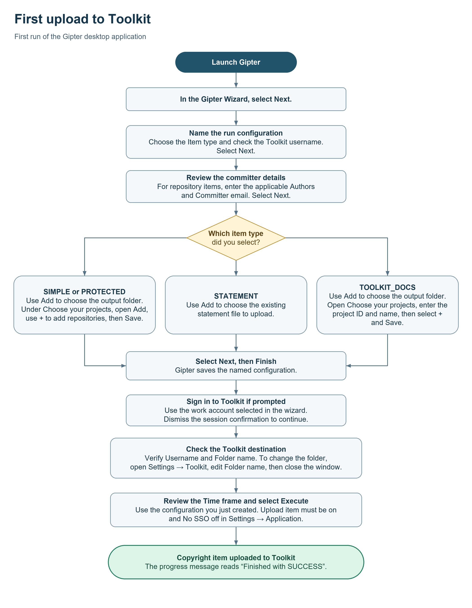
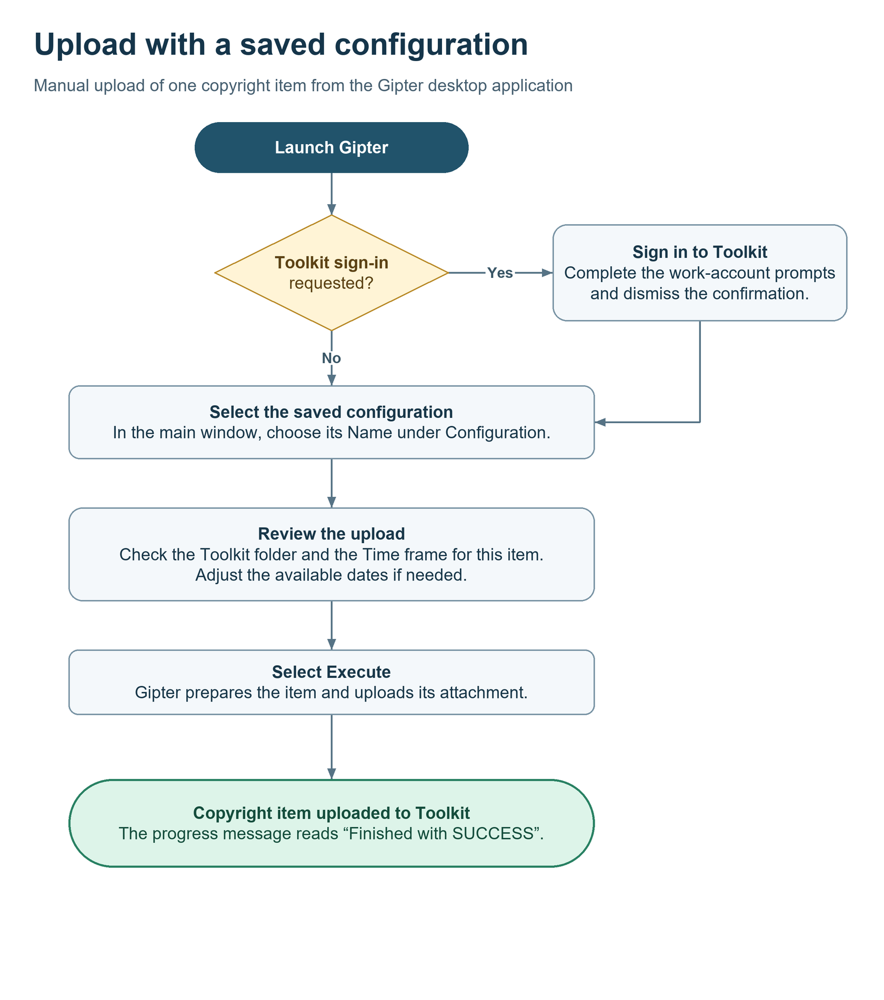
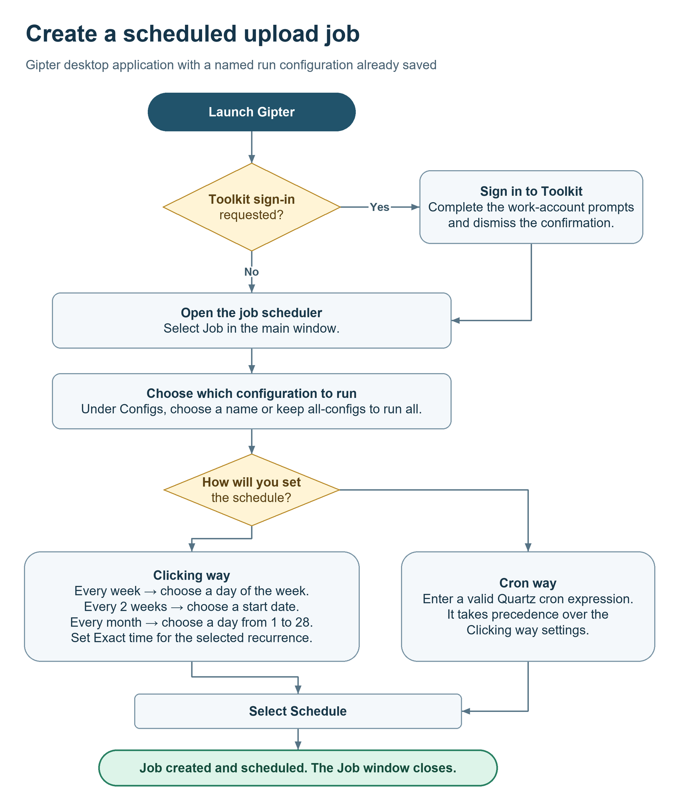
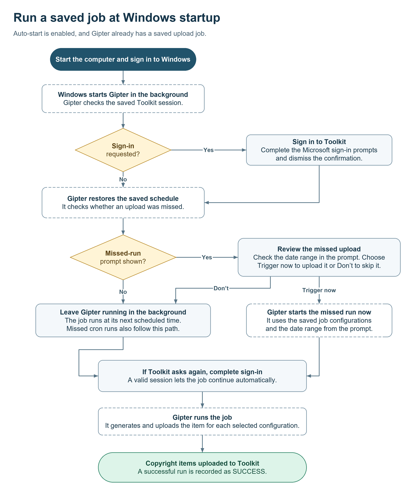

# Upload and scheduling workflows

## First upload to Toolkit

On first launch, finish the wizard with your Toolkit username, then sign in if prompted. The path you choose in the wizard depends on whether you are uploading repository changes, a statement file, or Toolkit documents.

[Download the editable draw.io diagram](https://raw.githubusercontent.com/PreCyz/GitDiffGenerator/5b6002d807e21bf96f443ec923a3b7f13e4e499e/docs/wiki/diagrams/first-run-toolkit-upload.drawio)

## Upload with a saved configuration

Select the saved configuration, check its destination and date range, and choose **Execute**. The progress message **Finished with SUCCESS** confirms the upload.

[Download the editable draw.io diagram](https://raw.githubusercontent.com/PreCyz/GitDiffGenerator/5b6002d807e21bf96f443ec923a3b7f13e4e499e/docs/wiki/diagrams/configured-toolkit-upload.drawio)

## Create a scheduled upload job

Open **Job**, choose the configuration, and set a recurrence or Quartz cron expression. Select **Schedule** to save the job.

[Download the editable draw.io diagram](https://raw.githubusercontent.com/PreCyz/GitDiffGenerator/5b6002d807e21bf96f443ec923a3b7f13e4e499e/docs/wiki/diagrams/configured-create-job.drawio)

## Run a saved job at Windows startup

With **Auto-start** enabled, sign in to Windows and leave Gipter running. If a missed-run prompt appears, **Trigger now** runs the missed upload and **Don’t** skips to the next scheduled run.

[Download the editable draw.io diagram](https://raw.githubusercontent.com/PreCyz/GitDiffGenerator/5b6002d807e21bf96f443ec923a3b7f13e4e499e/docs/wiki/diagrams/startup-with-scheduled-job.drawio)
